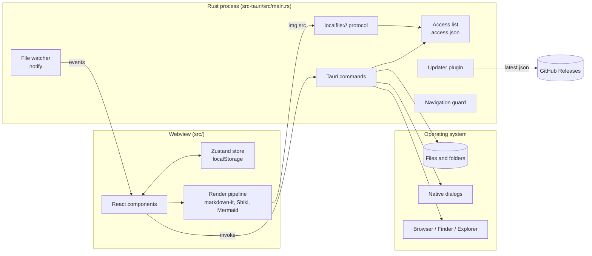
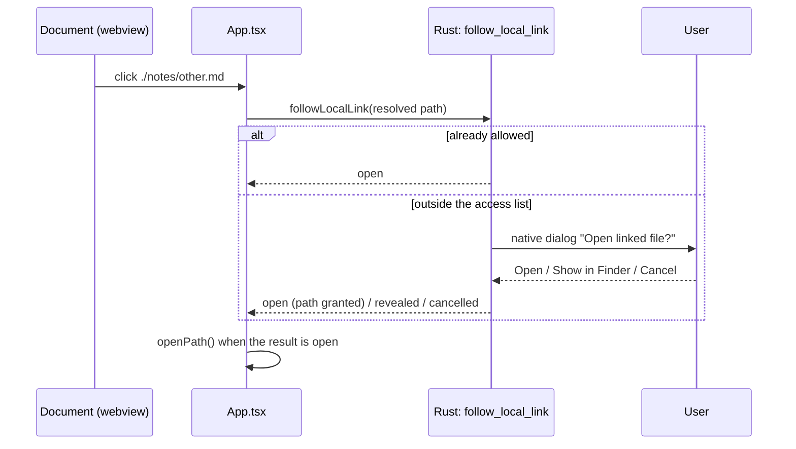
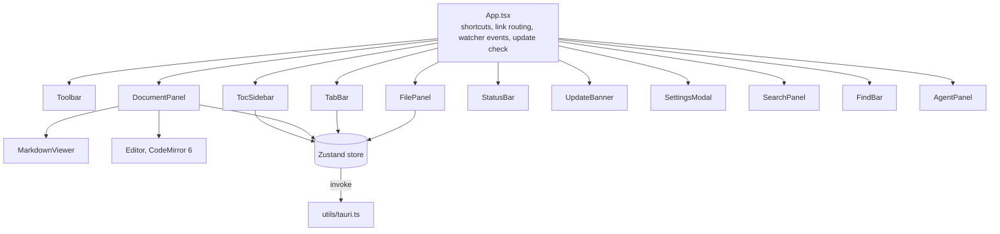
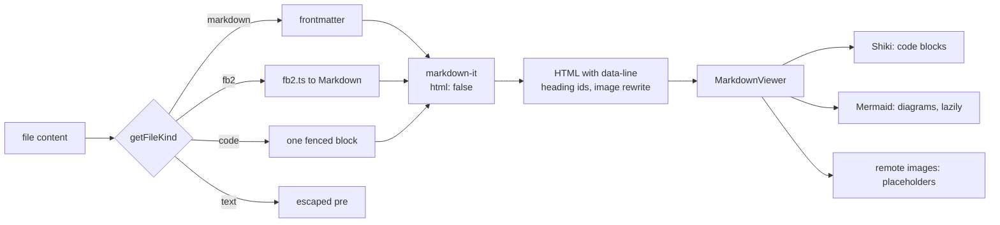
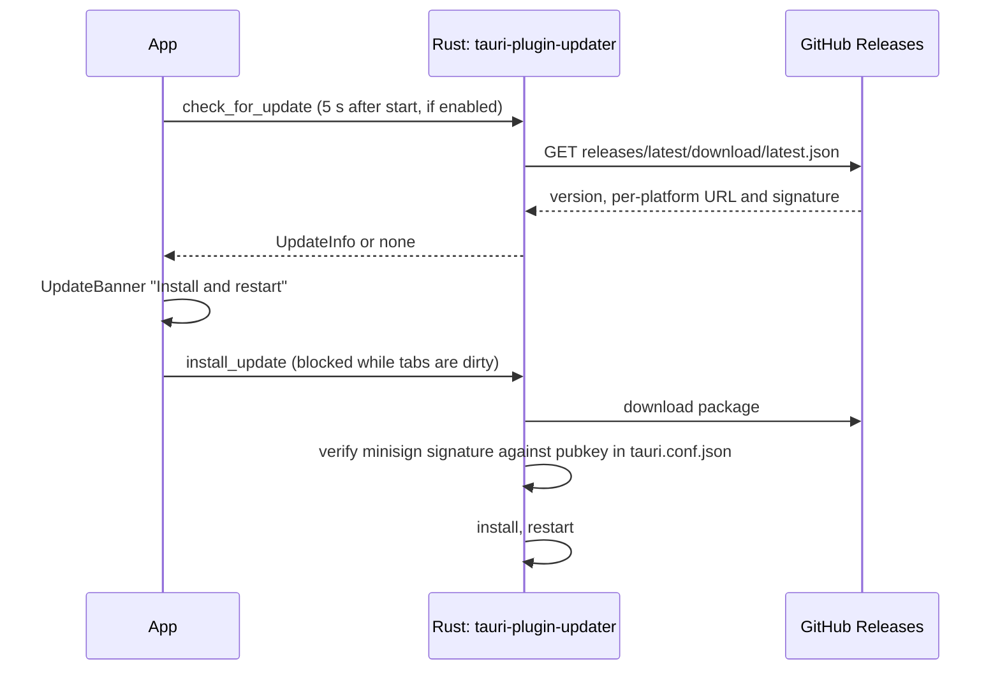

# MDViewer architecture

MDViewer is a desktop viewer and light editor for Markdown and other text documents. It is a [Tauri 2](https://tauri.app) app: a Rust process owns the window, the file system and the OS integration, and a React UI runs in the platform webview (WKWebView on macOS, WebView2 on Windows, WebKitGTK on Linux). The two talk only through Tauri commands, events and one custom protocol.

This document explains how the pieces fit and why they're shaped this way. For build commands and a file-by-file reference, see [README.md](README.md) and [CLAUDE.md](CLAUDE.md).

## Overview

| Layer | Technology | Where |
|---|---|---|
| Shell | Tauri 2, Rust | `src-tauri/` |
| UI | React 18, TypeScript, Vite | `src/` |
| State | Zustand with `persist` (localStorage) | `src/store/index.ts` |
| Rendering | markdown-it, Shiki, Mermaid, KaTeX (via Mermaid) | `src/utils/markdown.ts` |
| Editing | CodeMirror 6, lazy-loaded | `src/components/Editor.tsx` |
| Packaging | tauri-action on GitHub Actions | `.github/workflows/release.yml` |

## Trust boundary

The central design decision: **the webview is untrusted.** It renders documents written by other people, so anything in it may be hostile. Everything that touches the system goes through Rust, and Rust decides on its own whether a request is allowed.

- **Capabilities.** `capabilities/default.json` grants only `core:default` (plus window destroy). The JS file system, dialog, shell and opener plugins aren't exposed. Dialogs, the folder picker and opening links happen in Rust.
- **Access list.** Rust keeps a list of the files and folders the user opened (`Access` / `AccessState`, persisted to `access.json` in the config dir). Paths are added only by user actions that Rust observes itself: the folder picker, drag and drop (`on_window_event`), command-line and single-instance launch paths, and a confirmed `follow_local_link` dialog. No command adds a path just because the webview passed it.
- **Checks.** Every command turns its path argument into a `Target` (`named`, the path as given, and `real`, canonicalized with `dunce`) and calls `AccessState::check(target, Use)`. The `Use` says what the path is for:

  | Use | Allowed when |
  |---|---|
  | `List` (scan, watch) | the folder was opened, or is inside an opened folder |
  | `Open` (read, write, history) | an opened file, or a viewable document inside an opened folder |
  | `Stat` (metadata, reveal in file manager) | an opened file, or anything inside an opened folder |
  | `Image` (`localfile://`) | an image inside an opened folder, or in or below the folder of an opened file |

  With the agent workspace on, `Open` and `Stat` also allow markdown in fixed places inside the agents' folders (see [Agent workspace](#agent-workspace)).

  A symlink inside an opened folder passes when its real target fits the use (`Use::fits_target`): a `.md` link to a binary is neither listed nor readable. Paths containing `..` count only as their real location.
- **Rendering.** markdown-it runs with `html: false`, so raw HTML in documents is escaped, and every custom renderer rule escapes what it emits. Mermaid runs with `securityLevel: 'strict'`.
- **CSP** (`tauri.conf.json`): scripts only from the app (`'wasm-unsafe-eval'` for Shiki's regex engine), no frames, no objects, no forms, and `connect-src` limited to Tauri IPC. Documents can't phone home with `fetch`.
- **Navigation guard.** A small Tauri plugin (`navigation_guard`) blocks the webview from navigating away from the app's own pages. Link clicks are intercepted in `App.tsx` and routed: `#anchors` scroll, http(s)/mailto go to `open_external`, local files go to `follow_local_link`.
- **Remote images** are blocked by default: they render as `span.remote-image` placeholders, which avoids tracking pixels. The user can load them per document or turn them on in Settings.
- **Limits.** Documents are capped at 10 MB and images at 50 MB.

### Following a link

Opening a link to a file outside what the user opened is the one place where the webview's request can lead to new access, so Rust asks the user first:

The dialog is native, so script in the webview can't answer it.

## Backend (Rust)

Backend code lives in `src-tauri/src/main.rs`, with the agent workspace in `agent.rs`; unit tests are at the bottom of each (`cargo test`).

| Area | Commands / pieces |
|---|---|
| Files | `scan_directories`, `read_file`, `write_file`, `get_file_info` |
| Watching | `start_watching`, `stop_watching` (`notify`, one event per change, `node_modules`/`target`/`.git` ignored) |
| Dialogs | `pick_directory`, `export_file` |
| Links and shell | `follow_local_link`, `open_external`, `open_in_explorer` |
| History | `read_history`, `append_to_history`, `clear_history`, `get_history_path` |
| Session | `take_launch_paths`, `adopt_session_access` (one-time migration from before the access list) |
| Agent workspace | `agent_workspace`, `enable_agent_workspace`, `disable_agent_workspace`, `read_snapshot`, `mark_read` (`agent.rs`) |
| Updates | `check_for_update`, `install_update` |
| Protocol | `localfile://` serves images for `` tags |

Notable behaviour:

- **Encodings.** `read_file` decodes UTF-8, UTF-16 with BOM and XML-declared encodings (`encoding_rs`). `write_file` encodes back the same way and refuses encodings it can't round-trip.
- **Atomic saves.** `write_file` writes a temp file next to the target and renames it over the original.
- **Scanning.** `scan_directory_recursive` remembers which real folders it has listed, so a symlink back to a parent folder doesn't repeat the tree.
- **Single instance.** Launching MDViewer again with a path forwards that path to the running window (`tauri-plugin-single-instance`).
- **Errors.** Commands return `Result<_, AppError>`, which the frontend sees as a rejected promise with a message.

The config dir (`dirs::config_dir()/mdviewer`) holds only `access.json`, `history/history.md` and the agent workspace's `read-state/`. History is capped at 1000 entries, and its writes are serialized.

## Agent workspace

The agent panel shows what coding agents read and write: instructions, rules, memory, plans, skills, subagents and commands of Claude Code, Codex and Gemini CLI, and agent files in the opened folders (Cursor's `.cursor/rules/*.mdc` and `.cursorrules` among them). Discovery runs in Rust (`src-tauri/src/agent.rs`), so the webview never names the paths it gets.

- **Turning it on** is a native dialog (`enable_agent_workspace`). It sets `agent_workspace` in `access.json` instead of adding folders: granting `~/.claude` would expose settings and credentials, and `~/.claude/projects` holds session transcripts. While it's on, `agent::is_agent_document` allows only markdown at fixed paths (`CLAUDE.md`, `projects/*/memory/**`, `plans`, `skills`, `rules`, `agents`, `commands`, plugin skills; `AGENTS.md` and `prompts` for Codex; `GEMINI.md`). Paths are checked as named and as resolved, so a skill folder symlinked into a repo still works.
- **Read state.** `mark_read` stores a copy of the file in `read-state/` in the config dir. A scan marks a file unread when it changed after its copy and the text differs. Turning the workspace on marks everything read, so only later changes show.
- **What changed.** Opening an agent file fetches its copy (`read_snapshot`), diffs the lines (`diffContent` in `utils/agent.ts`, blank lines ignored), and marks the rendered blocks whose `data-line` range holds a changed line. Leaving the document marks it read.
- **Refresh.** `agent::Watch` watches the agents' homes (not recursively: they also hold transcripts), their agent subfolders and the opened folders, and emits `agent-files-changed` when an agent file changes (content events only; our own reads raise `Access` events). Each `agent_workspace` scan re-arms it, so newly opened or created folders are covered. While the panel or an agent file is open, the frontend rescans 500 ms after the last event and on window focus; if the watcher couldn't start, it polls every 10 s. Open agent files without unsaved edits reload when they change on disk.
- **Project names.** Claude Code names `~/.claude/projects/<dir>` after the project path with every non-alphanumeric character replaced by `-`. `decode_project_dir` walks the file system matching encoded folder names to recover the real path for the group label.

## Frontend (React)

- **One store.** `src/store/index.ts` holds everything: folders and file tree, open documents and tabs, navigation history, panel sizes, zoom, theme and settings. `persist` saves UI state, folders, tabs and workspaces to localStorage; document contents are re-read from disk on start. Actions that can fail return `{ success, error? }` instead of throwing.
- **Thin IPC layer.** `src/utils/tauri.ts` wraps every `invoke` with types. Components never call `invoke` directly.
- **Watching.** With auto-refresh on (the default), watcher events trigger a debounced rescan of the file tree (300 ms, never overlapping), and `setFiles` keeps unchanged tree nodes so React doesn't re-render the whole tree.
- **Editing.** `Ctrl+E` swaps the viewer for a CodeMirror editor. Editor state per document lives in `utils/editorRegistry.ts`, and `utils/save.ts` saves through `write_file`. Closing a tab with unsaved changes asks first, and installing an update is blocked while any tab has them.
- **Workspaces** save a set of folders, expanded paths and tabs under a name (`WorkspaceMenu`).
- **Theming.** CSS custom properties, dark by default with light overrides under `:root[data-theme='light']`. Shiki emits both themes at once, and Mermaid is re-initialized with matching theme variables.

### Render pipeline

`renderFile` turns content into HTML synchronously, so the document appears at once. Code highlighting and diagrams are filled in afterwards on the live DOM. Block elements carry `data-line` (the 0-based source line), which maps search hits and the editor position back to the rendered document. Relative image paths are rewritten to `localfile://` URLs, and Rust checks those against the access list when they're requested.

## Updates

The updater is used only from Rust; the webview just gets the version and notes. A package that doesn't match the public key in `tauri.conf.json` is rejected, so a compromised download host alone can't push code.

## Build and release

- **CI** (`ci.yml`, on push and pull request): TypeScript build, Vitest (`npm test`), `cargo clippy`, `cargo test`.
- **Release** (`release.yml`, on `v*` tags or manual run): a matrix builds macOS arm64 and x64, Windows x64 and Linux x64 with `tauri-action`, and attaches dmg, app.tar.gz, msi, NSIS exe, deb, rpm and AppImage to a GitHub release.
  - Update packages are signed with `TAURI_SIGNING_PRIVATE_KEY` (required, because `bundle.createUpdaterArtifacts` is on).
  - macOS code signing and notarization, and Windows signing via Azure Trusted Signing, switch on only when their secrets exist. Without them the builds are unsigned.
  - After all builds, the `updater-manifest` job collects the `.sig` files and publishes `latest.json`, which the installed apps poll.
- Manual runs (not tags) upload the binaries as workflow artifacts instead of making a release.

## Design choices

| Choice | Reason |
|---|---|
| Tauri, not Electron | Small download (about 8 MB on macOS), native webview, and a Rust side that is a natural place for the security boundary. |
| All system access in Rust, behind an access list | Documents are untrusted input, so a rendering bug must not become file system access. |
| Dialogs and links handled in Rust | Script in the page can't fake or click through a native dialog. |
| No raw HTML in Markdown | Removes the biggest XSS surface; the cost is that inline HTML shows as text. |
| One Zustand store | Small app; one place to look for state and persistence. |
| Synchronous render, async enhancement | The text is readable immediately; highlighting and diagrams fill in. |
| Updater keys separate from code-signing certs | Updates work and are verified even while the apps are unsigned. |
