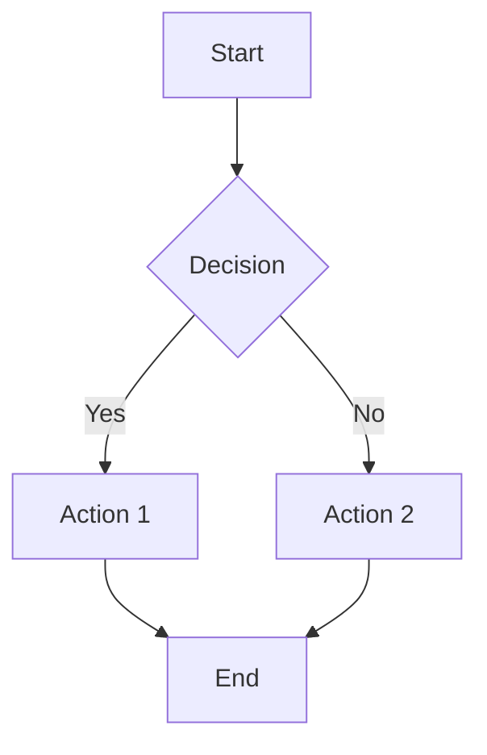

# MDViewer

A powerful, elegant markdown document viewer built with Tauri, React, and TypeScript.

## Features

- 📁 **Multi-directory browsing** with recursive file discovery
- 🎨 **Syntax highlighting** for 15+ programming languages (via Shiki)
- 📊 **Mermaid diagram support** - flowcharts, sequence diagrams, class diagrams, and more
- 📑 **Tabbed interface** for multi-document workflows
- 🤖 **Agent workspace** - the instructions, memory, plans and skills of Claude Code, Codex and Gemini CLI in one panel, with what changed since you last read them
- 📋 **Table of Contents** sidebar with scroll synchronization
- 🖱️ **Drag & drop** markdown files or folders onto the window to open them
- 🔍 **File search** with instant filtering
- 🔎 **Zoom control** with hover-expand UI
- 🌙 **IntelliJ IDEA-inspired dark theme** with fully customizable colors
- ⚡ **Fast and lightweight** - built with Tauri for minimal resource usage
- 🖥️ **Cross-platform** - Windows, macOS, and Linux

## Tech Stack

| Layer | Technology |
|-------|------------|
| Framework | Tauri 2.0 |
| Frontend | React 18 + TypeScript |
| State | Zustand |
| Markdown | markdown-it |
| Highlighting | Shiki |
| Diagrams | Mermaid 11 |
| Styling | CSS Variables + Custom Properties |

## Install

Download the installer for your platform from the
[latest release](https://github.com/lambda-house/mdviewer-mj/releases/latest):

| Platform | File |
|----------|------|
| macOS (Apple Silicon) | `MDViewer_<version>_aarch64.dmg` |
| macOS (Intel) | `MDViewer_<version>_x64.dmg` |
| Windows | `MDViewer_<version>_x64-setup.exe` or `MDViewer_<version>_x64_en-US.msi` |
| Linux | `.deb`, `.rpm` or `.AppImage` |

Installed packages register MDViewer as an app for `.md` and `.markdown` files. Double-clicking one opens it in MDViewer when the operating system selects MDViewer as the default. An existing default chosen by the user remains in place; select MDViewer in the system's **Open with** or default-app settings to switch it.

Unless the release was built with signing set up (see [Code signing](#code-signing)), the builds are not code-signed and the first launch needs one extra step:

- **macOS:** right-click MDViewer.app → Open, or run `xattr -dr com.apple.quarantine /Applications/MDViewer.app`
- **Windows:** on the SmartScreen warning, click "More info" → "Run anyway"

## Getting Started

### Prerequisites

- **Node.js** 18.x or later
- **Rust** 1.70 or later
- **npm** or **yarn**

### Installation

1. Clone the repository:
```bash
git clone git@github.com:lambda-house/mdviewer-mj.git
cd mdviewer-mj
```

2. Install dependencies:
```bash
npm install
```

3. Run in development mode:
```bash
npm run tauri dev
```

4. Build for production:
```bash
npm run tauri build
```

The build also produces signed update packages, so it needs the updater key (see [Updates](#updates)). Without the key, turn them off for a local build:
```bash
npm run tauri build -- --config '{"bundle":{"createUpdaterArtifacts":false}}'
```

On Linux, install the WebKitGTK build dependencies first:
`sudo apt install libwebkit2gtk-4.1-dev libappindicator3-dev librsvg2-dev patchelf`

### Releasing

CI (`.github/workflows/ci.yml`) typechecks the frontend and checks the Rust backend on every push and pull request.

To publish a release, bump the version in `package.json`, `src-tauri/tauri.conf.json` and `src-tauri/Cargo.toml`, add a `CHANGELOG.md` entry, then push a tag:

```bash
git tag v1.1.0
git push origin v1.1.0
```

`.github/workflows/release.yml` builds macOS (arm64 and x64), Windows x64 and Linux x64, and attaches the installers to a GitHub Release for that tag. Running the workflow by hand from the Actions tab builds the same installers as workflow artifacts without publishing a release.

### Updates

The app checks `https://github.com/lambda-house/mdviewer-mj/releases/latest/download/latest.json` a few seconds after it starts (Settings → General → Check for updates on start, or **Check now**). When a newer version is there, a bar under the toolbar offers **Install and restart**; nothing is installed without that click.

Every update package is signed with the updater key, and the app refuses packages whose signature doesn't match the public key in `tauri.conf.json` (`plugins.updater.pubkey`). The release workflow signs with two repository secrets, `TAURI_SIGNING_PRIVATE_KEY` (the key file's contents) and `TAURI_SIGNING_PRIVATE_KEY_PASSWORD`, and its `updater-manifest` job writes `latest.json` once all platforms are uploaded. Keep a backup of the key and its password: without them, installed copies can't be updated anymore and users would have to reinstall by hand.

The updater needs the repository to be public, because the app downloads release files without logging in.

### Code signing

The release workflow signs as soon as the secrets below exist (repository Settings → Secrets and variables → Actions); without them it builds unsigned installers. Signing is the first step of the [distribution roadmap](docs/DISTRIBUTION.md) (package managers and app stores).

**macOS** needs an Apple Developer Program membership and a "Developer ID Application" certificate:

| Secret | Value |
|--------|-------|
| `APPLE_CERTIFICATE` | The certificate exported from Keychain Access as `.p12`, base64-encoded (`base64 -i cert.p12`) |
| `APPLE_CERTIFICATE_PASSWORD` | The `.p12` export password |
| `APPLE_SIGNING_IDENTITY` | e.g. `Developer ID Application: Lambda House (TEAMID)` |
| `APPLE_ID`, `APPLE_PASSWORD`, `APPLE_TEAM_ID` | For notarization: the Apple ID, an app-specific password for it, and the team ID |

**Windows** uses [Azure Trusted Signing](https://learn.microsoft.com/azure/trusted-signing/): an Azure account with a Trusted Signing account and certificate profile, and an app registration allowed to sign with it:

| Secret | Value |
|--------|-------|
| `AZURE_CLIENT_ID`, `AZURE_CLIENT_SECRET`, `AZURE_TENANT_ID` | The app registration |
| `AZURE_SIGNING_ENDPOINT` | The account's region endpoint, e.g. `https://weu.codesigning.azure.net` |
| `AZURE_SIGNING_ACCOUNT`, `AZURE_SIGNING_PROFILE` | The Trusted Signing account and certificate profile names |

Linux packages are not signed.

## Project Structure

```
mdviewer/
├── src/                      # React frontend
│   ├── components/           # UI components
│   │   ├── Toolbar.tsx       # Top toolbar with zoom control
│   │   ├── FilePanel.tsx     # Left sidebar with file tree
│   │   ├── DocumentPanel.tsx # Main document viewer
│   │   ├── TocSidebar.tsx    # Right TOC sidebar
│   │   ├── Resizer.tsx       # Panel resize handles
│   │   └── StatusBar.tsx     # Auto-hide status bar
│   ├── store/                # Zustand state management
│   ├── utils/                # Utilities (markdown, files)
│   ├── styles/               # CSS styles and themes
│   ├── App.tsx               # Main app component
│   └── main.tsx              # Entry point
├── src-tauri/                # Rust backend
│   ├── src/
│   │   ├── main.rs           # Tauri commands, access list
│   │   └── agent.rs          # Agent workspace: discovery, read state
│   ├── Cargo.toml            # Rust dependencies
│   └── tauri.conf.json       # Tauri configuration
├── package.json
├── tsconfig.json
└── vite.config.ts
```

## Agent Workspace

In the Files panel, select **Agents** to show agent documents inside the folders you opened, including hidden `.claude` and `.cursor` folders. The normal **Files** filter shows only folders containing Markdown documents; the **Show text files** setting can also show other text files inside those folders.

**Global agent files** appears as a separate root below the opened folders in the same left column. Click the root to expand or collapse it. Hide it with the × on that row and show it again with the 🤖 button (Ctrl+Shift+A). It contains files in the agents' own folders:

| Section | What's in it |
|---|---|
| Instructions | `~/.claude/CLAUDE.md`, `~/.codex/AGENTS.md`, `~/.gemini/GEMINI.md` |
| Rules | Claude Code rules in `~/.claude/rules`, with what each applies to |
| Memory | Claude Code's per-project memory (`~/.claude/projects/*/memory`), grouped by project |
| Plans | `~/.claude/plans` (newest 100) |
| Skills | `SKILL.md` of user and plugin skills, with their descriptions |
| Agents, Commands | Subagent definitions and slash commands (`~/.codex/prompts` too) |

The first time you expand the root, select **Show agent files** to confirm access in a native dialog. Everything that is there then counts as read. After that, a dot marks files an agent has changed since you last read them, and **Changed since you read them** collects them at the top. Opening one highlights the changed blocks, with **Next change** and **Mark as read**; leaving the document marks it read too. While the root or an agent file is open, the list and open documents update as soon as an agent writes a file.

## Keyboard Shortcuts

The menu button (☰, top left) lists every command with its shortcut.

| Action | Windows/Linux | macOS |
|--------|---------------|-------|
| Open File | Ctrl+O | Cmd+O |
| Save File | Ctrl+S | Cmd+S |
| Save All | Ctrl+Shift+S | Cmd+Shift+S |
| Settings | Ctrl+, | Cmd+, |
| Toggle TOC | Ctrl+Shift+O | Cmd+Shift+O |
| Close Tab | Ctrl+W | Cmd+W |
| Zoom In | Ctrl+Plus | Cmd+Plus |
| Zoom Out | Ctrl+Minus | Cmd+Minus |
| Reset Zoom | Ctrl+0 | Cmd+0 |
| Next / Previous Tab | Ctrl+Tab / Ctrl+Shift+Tab | Ctrl+Tab / Ctrl+Shift+Tab |
| Reopen Closed Tab | Ctrl+Shift+T | Cmd+Shift+T |
| Toggle File Panel | Ctrl+B | Cmd+B |
| Toggle History | Ctrl+H | Cmd+H |
| Toggle Agent Panel | Ctrl+Shift+A | Cmd+Shift+A |

## Settings and Data

There is no config file to edit. Settings (theme, zoom, panel sizes, text colors), open folders, tabs and workspaces are saved by the app itself and restored on the next start. Change them in the app's Settings dialog.

The app keeps two files in its config folder (`~/Library/Application Support/mdviewer` on macOS, `~/.config/mdviewer` on Linux, `%APPDATA%\mdviewer` on Windows):

| File | Contents |
|------|----------|
| `access.json` | Folders and files you opened. The app reads only these (see below) |
| `history/history.md` | Which files you opened and when, newest 1000 entries |
| `read-state/` | Agent workspace only: a copy of each agent file as you last read it, to show what changed |

The only network requests the app makes on its own are the update check (when enabled) and, if you allow them, remote images in documents.

## Security

Documents come from anywhere, so the app treats them as untrusted:

- **File access is limited to what you opened.** The backend reads, lists and saves only inside folders you picked in the folder dialog, files you picked with Open File, folders and files you dropped on the window, and files the app was launched with ("Open with"). Inside an opened folder it only touches markdown and text files; inside an opened single file's folder it only serves images. The webview can't extend the list by naming a path, so a script that got into a rendered document still couldn't read `~/.ssh`. To revoke access, remove the entry from `access.json` while the app is closed.
- **Links to files you didn't open ask first.** Clicking a link to a file outside the opened folders and files shows a native "Open linked file?" dialog; only if you confirm is that file added. Symlinks inside an opened folder are followed when they point to a document (or image), never to anything else.
- **The agent workspace is opt-in.** The Global agent files root reads the agents' own folders (`~/.claude`, `~/.codex`, `~/.gemini`) only after you confirm a native dialog, and then only markdown in fixed places: `CLAUDE.md` / `AGENTS.md` / `GEMINI.md`, `projects/*/memory`, `plans`, `skills`, `agents`, `commands` and plugin skills. Settings, credentials and session transcripts are never read. The eye button on the expanded root turns access off; × hides the root.
- **Remote images are not loaded until you allow it**, since loading them tells their server when you read the document. Use **Load images** above the document, or turn on Settings → General → Load remote images.
- **Raw HTML in markdown is escaped**, not rendered, and links with `javascript:` and similar schemes are neutralised.
- **A Content Security Policy** blocks scripts other than the app's own, plugins, frames and network requests, as a second line of defence. The window can't be navigated away from the app: web links open in your browser.
- **Saving is atomic**: the new content is written to a temporary file next to the original and renamed over it, so a crash or power loss can't leave a truncated file. Saving a symlink updates its target.

## Theme Customization

MDViewer uses CSS variables for complete theme customization:

```css
:root {
  --surface-bg: #1e1e1e;
  --surface-elevated: #252526;
  --text-primary: #cccccc;
  --text-accent: #4fc1ff;
  --border-active: #007acc;
  /* ... and many more */
}
```

## Supported Languages (Syntax Highlighting)

- JavaScript / TypeScript
- Python
- Rust
- Scala
- Java
- Go
- SQL
- JSON / YAML
- Bash / Shell
- HTML / CSS
- C / C++
- And more...

## Mermaid Diagrams

MDViewer supports all major Mermaid diagram types:



## Linux / Raspberry Pi Rendering

WebKitGTK's DMA-BUF renderer produces a torn or corrupted window on Raspberry Pi
and some other ARM GL drivers ([tauri#9289](https://github.com/tauri-apps/tauri/issues/9289)).
MDViewer therefore sets `WEBKIT_DISABLE_DMABUF_RENDERER=1` for itself on Linux
before the webview starts.

Both parts are overridable through the environment:

| Variable | Effect |
|----------|--------|
| `MDVIEWER_ENABLE_DMABUF=1` | Keep WebKit's default DMA-BUF renderer (try this if rendering looks fine and you want maximum GPU performance) |
| `MDVIEWER_DISABLE_COMPOSITING=1` | Additionally set `WEBKIT_DISABLE_COMPOSITING_MODE=1` - a heavier fallback for drivers where disabling DMA-BUF is not enough |
| `WEBKIT_DISABLE_DMABUF_RENDERER=...` | Set it yourself and MDViewer leaves it alone |

## Contributing

Issues and pull requests are welcome.

## License

MIT License, © 2026 Lambda House. See [LICENSE](LICENSE).

## Acknowledgments

- [Tauri](https://tauri.app/) - Desktop framework
- [markdown-it](https://github.com/markdown-it/markdown-it) - Markdown parser
- [Shiki](https://shiki.matsu.io/) - Syntax highlighter
- [Mermaid](https://mermaid.js.org/) - Diagram library
- [Lucide](https://lucide.dev/) - Icons
- [Zustand](https://github.com/pmndrs/zustand) - State management
