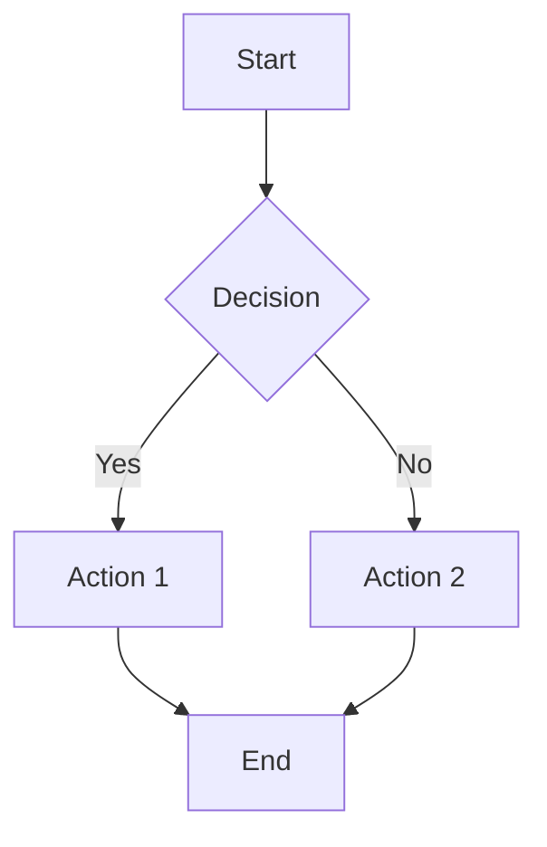

# MDViewer

A powerful, elegant markdown document viewer built with Tauri, React, and TypeScript.

## Features

- 📁 **Multi-directory browsing** with recursive file discovery
- 🎨 **Syntax highlighting** for 15+ programming languages (via Shiki)
- 📊 **Mermaid diagram support** - flowcharts, sequence diagrams, class diagrams, and more
- 📑 **Tabbed interface** for multi-document workflows
- 📋 **Table of Contents** sidebar with scroll synchronization
- 🖱️ **Drag & drop** markdown files or folders onto the window to open them
- 🔍 **File search** with instant filtering
- 🔎 **Zoom control** with hover-expand UI
- 🌙 **IntelliJ IDEA-inspired dark theme** with fully customizable colors
- ⚡ **Fast and lightweight** - built with Tauri for minimal resource usage
- 🖥️ **Cross-platform** - Windows, macOS, and Linux

## Tech Stack

| Layer | Technology |
|-------|------------|
| Framework | Tauri 2.0 |
| Frontend | React 18 + TypeScript |
| State | Zustand |
| Markdown | markdown-it |
| Highlighting | Shiki |
| Diagrams | Mermaid 10.x |
| Styling | CSS Variables + Custom Properties |

## Install

Download the installer for your platform from the
[latest release](https://github.com/lambda-house/mdviewer-mj/releases/latest):

| Platform | File |
|----------|------|
| macOS (Apple Silicon) | `MDViewer_<version>_aarch64.dmg` |
| macOS (Intel) | `MDViewer_<version>_x64.dmg` |
| Windows | `MDViewer_<version>_x64-setup.exe` or `MDViewer_<version>_x64_en-US.msi` |
| Linux | `.deb`, `.rpm` or `.AppImage` |

The builds are not code-signed yet, so the first launch needs one extra step:

- **macOS:** right-click MDViewer.app → Open, or run `xattr -dr com.apple.quarantine /Applications/MDViewer.app`
- **Windows:** on the SmartScreen warning, click "More info" → "Run anyway"

## Getting Started

### Prerequisites

- **Node.js** 18.x or later
- **Rust** 1.70 or later
- **npm** or **yarn**

### Installation

1. Clone the repository:
```bash
git clone git@github.com:lambda-house/mdviewer-mj.git
cd mdviewer-mj
```

2. Install dependencies:
```bash
npm install
```

3. Run in development mode:
```bash
npm run tauri dev
```

4. Build for production:
```bash
npm run tauri build
```

On Linux, install the WebKitGTK build dependencies first:
`sudo apt install libwebkit2gtk-4.1-dev libappindicator3-dev librsvg2-dev patchelf`

### Releasing

CI (`.github/workflows/ci.yml`) typechecks the frontend and checks the Rust backend on every push and pull request.

To publish a release, bump the version in `package.json`, `src-tauri/tauri.conf.json` and `src-tauri/Cargo.toml`, add a `CHANGELOG.md` entry, then push a tag:

```bash
git tag v1.0.4
git push origin v1.0.4
```

`.github/workflows/release.yml` builds macOS (arm64 and x64), Windows x64 and Linux x64, and attaches the installers to a GitHub Release for that tag. Running the workflow by hand from the Actions tab builds the same installers as workflow artifacts without publishing a release.

## Project Structure

```
mdviewer/
├── src/                      # React frontend
│   ├── components/           # UI components
│   │   ├── Toolbar.tsx       # Top toolbar with zoom control
│   │   ├── FilePanel.tsx     # Left sidebar with file tree
│   │   ├── DocumentPanel.tsx # Main document viewer
│   │   ├── TocSidebar.tsx    # Right TOC sidebar
│   │   ├── Resizer.tsx       # Panel resize handles
│   │   └── StatusBar.tsx     # Auto-hide status bar
│   ├── store/                # Zustand state management
│   ├── utils/                # Utilities (markdown, files)
│   ├── styles/               # CSS styles and themes
│   ├── App.tsx               # Main app component
│   └── main.tsx              # Entry point
├── src-tauri/                # Rust backend
│   ├── src/
│   │   └── main.rs           # Tauri commands
│   ├── Cargo.toml            # Rust dependencies
│   └── tauri.conf.json       # Tauri configuration
├── package.json
├── tsconfig.json
└── vite.config.ts
```

## Keyboard Shortcuts

| Action | Windows/Linux | macOS |
|--------|---------------|-------|
| Toggle TOC | Ctrl+Shift+O | Cmd+Shift+O |
| Close Tab | Ctrl+W | Cmd+W |
| Zoom In | Ctrl+Plus | Cmd+Plus |
| Zoom Out | Ctrl+Minus | Cmd+Minus |
| Reset Zoom | Ctrl+0 | Cmd+0 |
| Next / Previous Tab | Ctrl+Tab / Ctrl+Shift+Tab | Cmd+Tab / Cmd+Shift+Tab |
| Reopen Closed Tab | Ctrl+Shift+T | Cmd+Shift+T |
| Toggle File Panel | Ctrl+B | Cmd+B |
| Toggle History | Ctrl+H | Cmd+H |

## Settings and Data

There is no config file to edit. Settings (theme, zoom, panel sizes, text colors), open folders, tabs and workspaces are saved by the app itself and restored on the next start. Change them in the app's Settings dialog.

The app keeps two files in its config folder (`~/Library/Application Support/mdviewer` on macOS, `~/.config/mdviewer` on Linux, `%APPDATA%\mdviewer` on Windows):

| File | Contents |
|------|----------|
| `access.json` | Folders and files you opened. The app reads only these (see below) |
| `history/history.md` | Which files you opened and when, newest 1000 entries |

## Security

Documents come from anywhere, so the app treats them as untrusted:

- **File access is limited to what you opened.** The backend reads, lists and saves only inside folders you picked in the folder dialog, folders and files you dropped on the window, and files the app was launched with ("Open with"). Inside an opened folder it only touches markdown and text files; inside an opened single file's folder it only serves images. The webview can't extend the list by naming a path, so a script that got into a rendered document still couldn't read `~/.ssh`. To revoke access, remove the entry from `access.json` while the app is closed.
- **Raw HTML in markdown is escaped**, not rendered, and links with `javascript:` and similar schemes are neutralised.
- **A Content Security Policy** blocks scripts other than the app's own, plugins, frames and network requests, as a second line of defence.
- **Saving is atomic**: the new content is written to a temporary file next to the original and renamed over it, so a crash or power loss can't leave a truncated file. Saving a symlink updates its target.

## Theme Customization

MDViewer uses CSS variables for complete theme customization:

```css
:root {
  --surface-bg: #1e1e1e;
  --surface-elevated: #252526;
  --text-primary: #cccccc;
  --text-accent: #4fc1ff;
  --border-active: #007acc;
  /* ... and many more */
}
```

## Supported Languages (Syntax Highlighting)

- JavaScript / TypeScript
- Python
- Rust
- Scala
- Java
- Go
- SQL
- JSON / YAML
- Bash / Shell
- HTML / CSS
- C / C++
- And more...

## Mermaid Diagrams

MDViewer supports all major Mermaid diagram types:



## Linux / Raspberry Pi Rendering

WebKitGTK's DMA-BUF renderer produces a torn or corrupted window on Raspberry Pi
and some other ARM GL drivers ([tauri#9289](https://github.com/tauri-apps/tauri/issues/9289)).
MDViewer therefore sets `WEBKIT_DISABLE_DMABUF_RENDERER=1` for itself on Linux
before the webview starts.

Both parts are overridable through the environment:

| Variable | Effect |
|----------|--------|
| `MDVIEWER_ENABLE_DMABUF=1` | Keep WebKit's default DMA-BUF renderer (try this if rendering looks fine and you want maximum GPU performance) |
| `MDVIEWER_DISABLE_COMPOSITING=1` | Additionally set `WEBKIT_DISABLE_COMPOSITING_MODE=1` - a heavier fallback for drivers where disabling DMA-BUF is not enough |
| `WEBKIT_DISABLE_DMABUF_RENDERER=...` | Set it yourself and MDViewer leaves it alone |

## Contributing

Issues and pull requests are welcome.

## License

MIT License, © 2026 Lambda House. See [LICENSE](LICENSE).

## Acknowledgments

- [Tauri](https://tauri.app/) - Desktop framework
- [markdown-it](https://github.com/markdown-it/markdown-it) - Markdown parser
- [Shiki](https://shiki.matsu.io/) - Syntax highlighter
- [Mermaid](https://mermaid.js.org/) - Diagram library
- [Lucide](https://lucide.dev/) - Icons
- [Zustand](https://github.com/pmndrs/zustand) - State management
