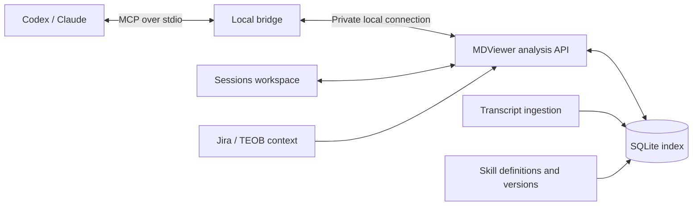

# Session analysis through MCP

**Status:** Descriptive MCP implementation available; see [implementation, validation and remaining limits](SESSION_ANALYSIS_MCP.md). The broader outcome/version model below remains the design target.
**Date:** 2026-11-07
**Application:** MDViewer Sessions workspace

## Purpose

Make MDViewer the evidence service that agents query to explain their work. The app collects and indexes activity; Codex or Claude investigates that evidence and answers questions with references the user can inspect in the desktop app.

Representative questions:

- Which tools account for most calls, observed waiting time or explicit failures?
- Where are agents repeating searches, commands or unsuccessful attempts?
- Which skills were invoked, read or merely mentioned?
- Does work associated with a particular skill use fewer tokens or require less rework on comparable tasks?
- Which sessions, subagents, tickets and memories explain a finding?

The initial scope is analysis. Terminal hosting and agent execution controls remain separate from this MCP contract.

## Architecture

The running app owns ingestion, the SQLite index and the analysis service. The UI and MCP clients use the same query layer and permission checks.

Each agent starts a small stdio bridge that connects to the running app. The bridge does not start another indexer. Disconnecting an agent closes its bridge without shutting down MDViewer. When the app is unavailable, the bridge returns a clear connection error.

For the first macOS implementation, use a private Unix-domain socket between the bridge and the app. A Windows implementation would need a corresponding local transport, such as named pipes. Remote access is a later decision.

Both [Codex](https://learn.chatgpt.com/docs/extend/mcp?surface=cli) and [Claude Code](https://code.claude.com/docs/en/mcp) support local stdio MCP servers. MCP defines initialization, capability negotiation and shutdown in its [lifecycle specification](https://modelcontextprotocol.io/specification/2025-11-25/basic/lifecycle).

## Proposed MCP tools

These names describe the proposed contract, not commands available in the current build.

| Tool | Purpose | Principal inputs |
|---|---|---|
| `analysis_status` | Report freshness, pending ingestion, parser versions and telemetry coverage. | Optional repository/session scope. |
| `find_sessions` | Locate sessions and their relationships. | Repository, dates, provider, model, human/subagent role, ticket, skill evidence and cursor. |
| `get_session` | Return hierarchy, recorded usage, work associations and available evidence. | Provider and session ID. |
| `analyze_tools` | Summarize calls, matched results, explicit failures, timing distributions and repeated-call candidates. | Session cohort, tool filter, grouping and event-time range. |
| `analyze_skills` | Summarize skill observations, versions and associated activity. | Session cohort, skill identity/version and observation type. |
| `compare_cohorts` | Compare specified groups while exposing sample sizes and differences in task/model composition. | Two cohort definitions, metrics and matching dimensions. |
| `get_evidence` | Retrieve bounded excerpts, call/result pairs or captured skill definitions behind a finding. | Evidence IDs and pagination. |

The API exposes typed, bounded queries. Agents receive aggregates first and retrieve detailed evidence when needed.

Results use MCP `structuredContent` with compatible text content, following the [tools specification](https://modelcontextprotocol.io/specification/2025-11-25/server/tools). Input and output schemas should be versioned and validated.

Every analytical result includes:

- Applied filters and their time semantics.
- Index generation and freshness timestamp.
- Coverage, missing fields, pending ingestion and truncation.
- Metric definitions and attribution limitations.
- Stable evidence identifiers that resolve to activity in MDViewer.

### Scope and time semantics

Session selection and event selection are separate operations:

- **Session last activity:** selects sessions by their last recorded activity. Lifetime usage for these sessions remains lifetime usage.
- **Event-time range:** selects facts recorded within a time interval. Usage within that interval requires timestamped usage facts.
- **Hierarchy scope:** explicitly selects one session, its descendants or a larger cohort. Aggregations count each owned fact once.

Queries and pagination should use an index-generation watermark so new ingestion does not silently change the population halfway through an investigation. The precise cursor lifetime is an implementation decision.

## Evidence model

The current parser retains tool names and activity previews but discards the IDs linking tool calls to results. Richer analysis requires preserving those relationships.

| Record | Important fields |
|---|---|
| Session | Provider, session ID, parent/fork relationships, origin, historical directories and source identity. |
| Turn/response | Owning session, response ID, timestamps, model and reasoning effort where recorded. |
| Tool invocation | Owning turn, call ID, namespace, argument fingerprint, timestamps and source reference. |
| Tool result | Matching call ID, explicit error/exit information, recorded duration, output size and source reference. |
| Usage | Owning response/turn, input/output/cache tokens and deduplication identity. |
| Skill version | Identity, source location, content hash, captured content and capture time. |
| Skill observation | Identity/version where known, observation type, owning session/turn and evidence. |
| Work outcome | Task/ticket association, verification evidence, completion/reopening signals and attribution confidence. |

Facts should preserve source offsets or equivalent durable references, parser versions and derivation methods. Repeated observations and copied fork history must be distinguished from newly executed work where the source permits it. Unresolved ownership remains visible in coverage reports.

Richer facts can be backfilled incrementally from original transcripts. Existing checkpoints and summaries should remain usable during migration, with analysis coverage clearly marked as partial. A query should not trigger an unbounded full-history scan.

Historical skill versions that were never captured remain unknown. Today's skill definition must not be represented as the instructions used by an earlier session.

### Wrapped tool calls

A recent local transcript sample showed many Codex operations wrapped in `exec`. Preserve the outer invocation and any independently evidenced inner calls.

A tool name appearing inside executable text establishes a reference, not proof that it ran. References, observed invocations and observed results need separate classifications. This prevents wrapper calls from concealing activity without inventing inner executions.

## Measuring tool and skill efficiency

Skill observations must distinguish:

1. Available in the agent's recorded context.
2. Definition requested or successfully read.
3. Explicitly invoked.
4. Agent claimed to follow it.
5. Resulting work passed a relevant verification.

These observations support different conclusions. The presence of a local skill file alone establishes neither availability in a historical session nor use.

Initial descriptive measures:

| Measure | Interpretation and limits |
|---|---|
| Invocation volume | Count distinct observed calls, accounting for duplicate transcript records. |
| Explicit failures | Use recorded error/exit information. Missing error flags do not establish success. |
| Repeated-call candidates | Repeated inputs invite investigation; they do not automatically establish a retry or waste. |
| Call-to-result elapsed time | Includes scheduling and transport. Separate recorded execution duration where available. Overlapping calls cannot be summed as wall-clock time. |
| Input/output volume | Bytes or characters are descriptive measures, not inferred token counts. |
| Recorded tokens | Attribute at response/session level unless finer attribution is supported. Cached input and reasoning remain subsets of input/output. |
| Verification and rework | Link checks and follow-up activity to the relevant task with stated confidence. A successful command alone does not establish task completion. |

Skill-associated session tokens describe the surrounding work. They are not tokens caused by the skill, and totals across skills can overlap.

### Effectiveness comparisons

For a question such as “Does the delivery skill reduce failed deployment attempts?”, an agent would:

1. Find sessions with evidenced use of the relevant skill and version.
2. Identify comparable tasks and a comparison cohort.
3. Compare failures, recorded usage, verification outcomes and rework.
4. Inspect representative source traces and exceptions.
5. Report sample sizes, missing outcomes and differences in model, task difficulty or operating conditions.

Historical comparisons can reveal associations. Stronger causal claims require controlled evaluations with defined tasks and acceptance criteria. The service should supply measurements and evidence rather than a universal skill-success score.

## Jira and TEOB context

Jira supplies task and delivery context. TEOB supplies linked memory and decisions. Associations should distinguish explicit links from extracted mentions.

A ticket mention alone remains a mention. A recorded memory-tool call alone does not prove a successful write. Remote context should carry its source and retrieval time, and use the app's configured connection permissions.

Credentials are not part of MCP results. An agent asking an analytical question should receive the relevant work context, not connection secrets.

## User experience and access

Add an **Agent access** view showing:

- Whether the analysis service is enabled and which clients are connected.
- The shared repository/session scope.
- Whether detailed transcript excerpts and skill definitions can be retrieved.
- Recent tool queries, their scope and completion status.
- Connection instructions and a revoke action.

The backend enforces scope on every request. MCP read-only annotations describe tool behavior; they do not replace authorization. Returned transcript text is untrusted evidence, not instructions for the querying agent.

Evidence references should let the user move from an agent's finding to the corresponding session, call/result pair or skill observation in the desktop app.

## Delivery sequence and review gates

| Stage | Deliverable | Acceptance evidence |
|---|---|---|
| 1. Session evidence | Local bridge, status/session queries and bounded evidence retrieval. | Real MCP client discovers and calls tools against the running app; app-off behavior, revocation, scope enforcement and pagination work. |
| 2. Tool and skill facts | Correlated calls/results, wrapper classifications, skill observations and version capture. | Known fixtures and sampled real traces reproduce counts; restart and duplicate ingestion do not inflate them; historical gaps remain explicit. |
| 3. Outcome comparisons | Cohort comparison with Jira/TEOB context and verification evidence. | Reports expose matching criteria, overlap, missing outcomes and source references; unsupported causal or token attribution is not presented as fact. |

Recommended review decisions:

- Start with local Codex/Claude clients connected to the running desktop app.
- Keep the MCP surface read-only for this analysis phase.
- Deliver session/evidence access before efficiency comparisons.
- Capture skill versions prospectively and label historical version gaps.
- Use descriptive metrics first; add outcome-backed comparisons once their evidence is available.

The implementation proposal should follow review of this contract and its evidence semantics.
